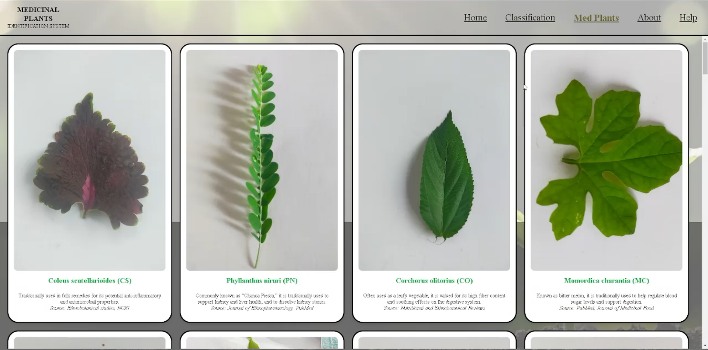
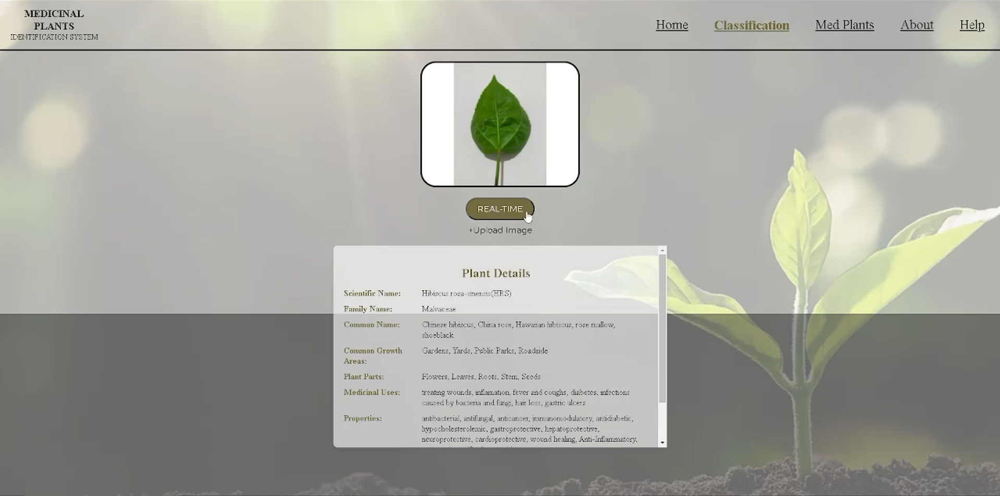

# Medicinal Plants Identification System
 
**A web app that identifies 48 medicinal plant species from a leaf image, by photo upload or real-time camera, using a hybrid deep learning model with 98.5% accuracy.**
 

 

---
 
## Overview
 
Up to 80% of the world's population relies on herbal medicine, yet identifying medicinal plants by eye is slow and error-prone, and mistaking one plant for another can be dangerous.
 
The **Medicinal Plants Identification System** solves this with a web application that recognizes a plant from a photo of its leaf. Users can **upload an image** or use their **camera in real time**, and the system returns the plant's scientific name, family, common names, growth areas, parts used, medicinal uses, and properties.
 
This project is my **BS Computer Science (Intelligent Systems) thesis** at Laguna State Polytechnic University, titled *"Image Classification and Recognition of Medicinal Plants using Hybrid Approach of Deep Learning Algorithms"* (2025). I was the **sole developer and programmer** of the entire system: dataset preparation, model training, web application, and database.
 
---
 
## Screenshots
 

### Home

### Medicinal Plants Gallery

### Plant Classification

---
 
## Features
 
**Plant classification**
- **Upload Image** to classify a leaf from a saved photo
- **Real-Time** mode to identify plants through the live camera
- Instant **Plant Details**: scientific name (with short code), family, common names, common growth areas, plant parts used, medicinal uses, and properties
**Medicinal plants gallery**
- Card-based catalog of all **48 supported species**, each with a photo, scientific name, short description of traditional use, and cited sources (e.g. PubMed, NCBI)
**Website**
- Clean landing page and simple navigation: **Home, Classification, Med Plants, About, Help**
---
 
## The Model
 
The system uses a **hybrid deep learning approach**: a neural network extracts features from the leaf image, and a Support Vector Machine (SVM) classifies them. Three hybrid models were built and compared, and **YOLO11** was added for real-time detection.
 
| Model | Training Accuracy | Validation Accuracy |
|---|:---:|:---:|
| CNN + SVM | 98.4% | 97.9% |
| DNN + SVM | 94.0% | 91.5% |
| **Autoencoder + SVM** (best) | **98.8%** | **98.5%** |
 
- **YOLO11** is used for real-time plant detection, reaching **99.4% accuracy** and **0.994 mAP@0.5** with a small footprint (about 60 MB, 8M parameters)
- Evaluated with accuracy, precision, sensitivity (recall), specificity, and F1-score, plus confusion matrices
- Known limitation: most errors happen between species with visually similar leaf shapes and textures
### Dataset
 
- Built on a [medicinal plant dataset from Mendeley Data](https://data.mendeley.com/datasets/tsvdyhbphs/1) (40 species, validated by agriculture experts at UPLB)
- **Manually cleaned and expanded** to **7,200 images**: **150 images per species** across **48 species**
- Preprocessing: resizing, standardization, normalization, and augmentation
- Split: 70% training, 20% validation, 10% testing
- Species metadata (scientific and common names, family, parts used, medicinal benefits, regions) was compiled and validated by agriculture experts
---
 
## System Evaluation
 
The system was evaluated against the **ISO/IEC 25010** software quality standard:
 
| Quality Characteristic | Mean | Interpretation |
|---|:---:|---|
| Functional Suitability | 4.56 | Agree |
| Performance Efficiency | 4.35 | Agree |
| Compatibility | 5.35 | Strongly Agree |
| Usability | 4.78 | Agree |
| Reliability | 4.15 | Agree |
| Security | 4.10 | Agree |
| Maintainability | 4.10 | Agree |
| Portability | 5.12 | Strongly Agree |
 
---
 
## Tech Stack
 
| Layer | Technology |
|---|---|
| Backend / web framework | Python, Django |
| Frontend | HTML, CSS, JavaScript |
| Database | MongoDB |
| Computer vision | OpenCV |
| Models | Autoencoder + SVM, CNN + SVM, DNN + SVM, YOLO11 |
| Tools | Visual Studio Code, RapidMiner |
 
---
 
## Source Code
 
The source code for this project is not publicly available. This repository is a showcase of the system only.
 
---
 
## Thesis
 
**Image Classification and Recognition of Medicinal Plants using Hybrid Approach of Deep Learning Algorithms**
Laguna State Polytechnic University, San Pablo City Campus, College of Computer Studies (May 2025)
 
Thesis researchers: Jacob Y. Aguilar, Jhay Landrei B. Marcelino, Ian Paul P. Suaze
System developed and programmed solely by Jhay Landrei B. Marcelino.
 
---
 
## Disclaimer
 
The information in this app is for **educational purposes only** and comes from published ethnobotanical sources. It is not medical advice. Always consult a qualified healthcare professional before using any plant for medicinal purposes.
 
---
 
## Author

**Jhay Landrei Marcelino**: Full-Stack Software Developer (Flutter, Dart, Go, Python, C#/.NET) based in Laguna, Philippines.

---

## Notes

Screenshots use sample/demo data. This repository is just the portfolio showcase of the thesis project; the source code is not included.

© 2025 Medicinal Plants. All rights reserved.
